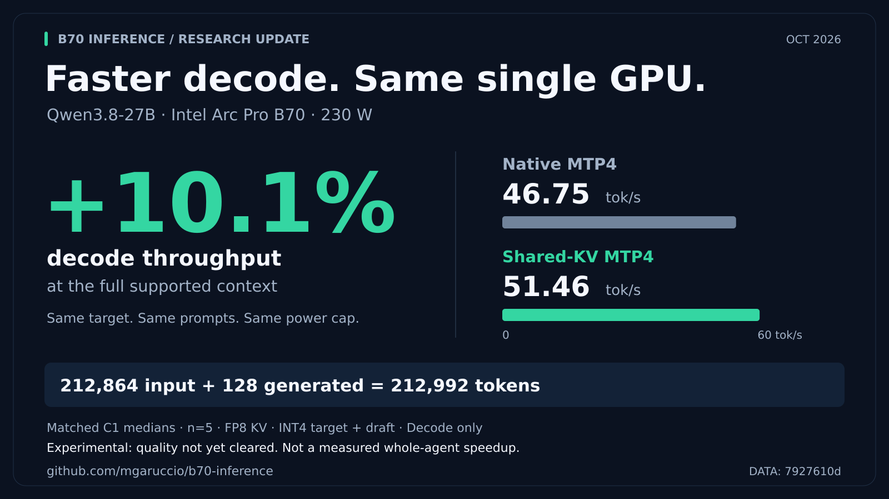

# B70 inference

Public notes, plans, and tooling for serving large local models on a single
**Intel Arc Pro B70** (Battlemage G31, 32 GB, `xe` driver).

This is the hardware-optimization workspace. Evaluation wiring, Prime
tasksets, and hosted NVIDIA cells stay in
[local-dev-model](https://github.com/mgaruccio/local-dev-model).

Two models share the card. Only one is resident at a time.

| Model | Engine | Spec | Current C1 decode | Notes |
| --- | --- | --- | ---: | --- |
| **Muse Glimmer 30B GPTQ** | vLLM XPU | DFlash n=20, GPTQ draft | **89.1 / 101.1 / 42.6** tok/s (GSM8K / HumanEval / MT-Bench, greedy, until stop) | Moved to [muse-glimmer-b70](https://github.com/mgaruccio/muse-glimmer-b70) |
| Qwen3.8-27B GPTQ-Int4 | vLLM XPU | Native MTP-4, FP8 KV | **61.18 / 46.75** tok/s native at ~128K/full context (matched 230 W run) | Default: 212,992-token C1, no KV offload. Experimental shared-KV: **66.03 / 51.46** on the same inputs; not promoted. |

Public llama.cpp Muse-on-B70 numbers from others are ~27–29 tok/s. The vLLM stack is a different path (GPTQ W4A16 + graphs + DFlash n=20), measured until stop with visible answers.

## Qwen update: ~10% faster long-context decode on one B70

Our experimental **shared-KV MTP4** path improves median decode throughput by
**9.35% at 160K, 10.25% at 192K and 10.08% at the full 212,992-token window**.
At the limit: **46.75 → 51.46 tok/s**, on the same B70 at **230 W**, with the same
model, prompts and serving settings. Five measured prompts per point; 128 output
tokens; decode only.



This targets an important part of long-running agent workloads: generating new
tokens while carrying a large history. **It is not a measured whole-agent
speedup.** The candidate is still experimental: HumanEval+ qualification remains
unresolved, output differences exist, and production remains native MTP4.

[Public research update and context/gain chart](docs/qwen38-shared-kv-long-context.md)
· [Exact measurements and raw evidence](results/20261009-qwen38-community-protocol/README.md)
· [Twitter draft and two ready-to-use images](docs/qwen38-shared-kv-social.md)

## Experimental shared-KV recipe

**For advanced users reproducing the experiment; not a production default or a
one-command installer.** Start with a working [native Qwen configuration](docs/qwen38-b70-golden-config.md).
The shared-KV path is opt-in: earlier HumanEval+ results were **136/164 versus
139/164 native**, and quality neutrality is still unresolved. Keep your native
launcher intact and use a separate experimental copy.

The locality investigation was motivated by the community's
[lithos-metal megakernel work](https://github.com/lithos-ai/lithos-metal).
This recipe is a narrower **vLLM/XPU shared-KV verification optimization**, not
a port of that Metal engine or a whole-model megakernel.

### Tested configuration

| Component | Configuration |
|---|---|
| GPU | One Intel Arc Pro B70, 32 GB; matched benchmarks at **230 W** |
| Model export | `SergiioB/Qwen3.8-27B-GPTQ-Int4-sym-G128-MTP-BF16` |
| Target / KV | GPTQ symmetric G128, `--dtype float16`, `--kv-cache-dtype fp8` |
| Speculation | Native MTP4; draft INT4 **S+M1**; mixed-GDN-v5 patches in both arms |
| Serving | Context **212992**, utilization **0.95**, `--max-num-seqs 1`, batch-token budget **8192** |
| Cache / reasoning | Prefix caching on, `--mamba-cache-mode align`, thinking on |
| Execution | XPU graphs on; `--cudagraph-metrics` for runtime evidence |
| Candidate | Unchanged **build-06** library and its accompanying serving adapter |

Pinned image:

```text
vllm/vllm-openai-xpu@sha256:f01e24f6c7ff01f1e0662234255a1372297d1dbd89d003cf13c8fad3eab1ba4f
```

The adapter checks exact layouts, including the measured FP8 cache shape
`[152,1664,4,256]` and block-table shape `[1,128]`. Matching the headline model name
is insufficient: different memory/context/batching settings can select the native
fallback. Do not remove these checks just to make another configuration run.
The launcher does not set GPU power; 230 W was an explicit benchmark setting,
not a change to the persistent default.

### Get the experimental build

From the repository root, verify and extract the committed bundle into a separate
directory. It includes the prebuilt library, source/build inputs and adapters:

```bash
set -euo pipefail
printf '%s  %s\n' \
  f72301b2e55166dc213f2e18501e79f17e0501f8330ec36bc1e33ec0de75a8f5 \
  results/20261009-qwen38-native-shared-kv/reused-candidate.tar.gz | sha256sum -c -
EXPERIMENT="$(mktemp -d "${TMPDIR:-/tmp}/qwen38-shared-kv.XXXXXX")"
tar -xzf results/20261009-qwen38-native-shared-kv/reused-candidate.tar.gz -C "$EXPERIMENT"
export CANDIDATE="$EXPERIMENT/reused-candidate/20260913-qwen38-native-grouped-verify"
export WORKER_PATCH="$EXPERIMENT/reused-candidate/20260913-qwen38-mtp4-draft-attribution/timing/qwen38_step_timing_patch.py"
printf '%s  %s\n' \
  e0c6f2a78a1a50eef9dcc11b9c378c2e94799a3f5ffa0c8971849f03b3c1ddec \
  "$CANDIDATE/build-06/build/libb70_grouped_verify.so" | sha256sum -c -
cp scripts/start-qwen38.sh "$EXPERIMENT/start-experimental.sh"
```

### Apply the overlay to the private launcher

First adapt `ROOT`, `MODEL_DIR` and `COOKBOOK` in the private copy to your existing
native installation; the checked-in launcher contains our host paths. Use a
separate container name and localhost port binding for the experiment. Preserve
the native model patches, environment and serving arguments.

Add these arguments to its `docker run` command **before `--entrypoint`**:

```bash
-v "$CANDIDATE/serving-overlay.py:/experiment/qwen38_step_timing_overlay.py:ro" \
-v "$WORKER_PATCH:/experiment/qwen38_step_timing_patch.py:ro" \
-v "$CANDIDATE/grouped_verify.py:/experiment/grouped_verify.py:ro" \
-v "$CANDIDATE/build-06/build/libb70_grouped_verify.so:/candidate/libb70_grouped_verify.so:ro" \
-e PYTHONPATH=/experiment \
-e B70_STEP_TIMING=1 \
-e B70_GROUPED_SERVING=1 \
-e B70_GROUPED_SERVING_LIBRARY=/candidate/libb70_grouped_verify.so \
```

Inside the container's shell command, run
`/opt/venv/bin/python -P /experiment/qwen38_step_timing_patch.py` after the existing
patch commands and immediately before `exec vllm serve`. Add
`--cudagraph-metrics` to the serving arguments. These are the additions used by
the [tested private-launcher controller](results/20261009-qwen38-community-protocol/run-230w.py).
The controller itself is **host-specific** (paths, boot/CPU/power guards); do not
run it unchanged on another machine or bypass its guards to do so.

After making those edits, launch from the same Bash session so the exported
mount paths are available:

```bash
bash "$EXPERIMENT/start-experimental.sh" 2>&1 | tee "$EXPERIMENT/server.log"
```

In another terminal, send a generation request to your chosen localhost port
(example uses 8000), then inspect the server log as described below:

```bash
curl --fail-with-body http://127.0.0.1:8000/v1/chat/completions \
  -H 'Content-Type: application/json' \
  -d '{"model":"qwen38","messages":[{"role":"user","content":"Explain what a KV cache does."}],"max_tokens":128,"temperature":0,"ignore_eos":true}'
```

### Verify the backend before quoting a result

- Confirm `[B70_GROUPED_SERVING]` reports installation and `eligible-dispatch`
  with the build-06 SHA256 above. An unsupported-Q5 message means this configuration
  did not establish the intended optimized path.
- Confirm FULL graph capture completes, then exercise real generation requests
  and retain the `FULL` runtime-statistics rows produced by `--cudagraph-metrics`.
  Startup eligibility alone is not per-request proof; its diagnostic logging is
  bounded and absence of a fallback message is not proof of no later fallback.
- Use the same prompts, output lengths, cache policy and power cap for native and
  candidate; check actual token counts and prefix-cache hits. Keep output/quality
  checks separate from the throughput claim.
- The [recorded benchmark protocol and artifacts](results/20261009-qwen38-community-protocol/README.md)
  contain the working launch copies, exact requests, verification and cleanup.

**Return to native:** stop only your experimental container and start your
untouched native launcher. Do not retain the shared-KV mounts, environment or
worker-import patch in that native launch. Remove the temporary extraction only
after the experimental container has stopped. No production promotion is implied.

## Earlier Qwen four-way comparison — 2026-09-14

One fresh forward/reverse campaign, identical workloads, twelve measured samples per configuration/context:

| Context | Native MTP4 | Custom MTP4 | DFlash2 INT4 | DSpark Split-K |
|---|---:|---:|---:|---:|
|512|70.77|69.48|76.29|52.55|
|8K|63.97|63.45|60.76|42.95|
|32K|61.36|63.27|50.28|37.47|
|64K|55.12|57.93|45.13|31.14|

Median post-first streaming decode tok/s, B70/275W/C1. These compare selected best bundles with disclosed runtime/capacity/batch differences, not normalized algorithms. [Full matched speed results, IQRs, TTFT and exact commands](results/20260914-qwen38-four-way-speed/README.md). DFlash has the lowest64K whole-request latency for128 output tokens despite custom MTP4's faster decode.

**Custom is not promoted:** the [full quality evaluation](results/20260913-qwen38-grouped-quality/README.md) found HumanEval+82.93% versus native84.76% (three fewer passes); runtime nondeterminism also exists. Quality neutrality is not established. The matched custom/native64K speed gain is **+5.11%**, not the earlier separate-run+8.85%.

[Current session handoff and optional follow-up](docs/qwen38-b70-next-session.md) · [Unchanged production defaults](docs/qwen38-b70-golden-config.md). All tests are development-tier; production remains native MTP4 and is stopped after experiment cleanup.

## New Glimmer concurrency profile — 2026-09-05

**C8 / DFlash K3 / native 131072 context:** **303.1 aggregate e2e tok/s** at eight clients after long-context stress, on the matched 256-output-token workload. The same-session K4 baseline was **282.2** (**+7.4%**); the earlier native-context K4 result was 278.1. This is not per-stream decode and is separate from the completed-answer table above. A later 350 tok/s attempt did not beat this bar with a reproducible launcher change.

K3 passed 16/16 completed-answer smoke checks, eight concurrently resident ~64k prompts, dynamic queue/drain, and single-request ~129k retrieval, with zero preemptions. **Known limit:** the earlier K4 forced-length, near-capacity six-request empty-response failure was not retested or fixed. Keep this as a research profile, not an unrestricted production-safety claim.

- [K3 hill-climb, repeated measurements, and exact validation](docs/glimmer-b70-hillclimb-20260905.md)
- [350 attempt: scheduler/kernel sweep, 350 not reached](docs/glimmer-b70-hillclimb-350-20260905.md)
- [Original public K4 configuration and reproduction](https://github.com/mgaruccio/muse-glimmer-b70/blob/main/docs/concurrency.md)
- [Original K4 concurrency/context measurements and caveats](docs/glimmer-b70-concurrency-20260905.md)
- [Separate C8/K3 launcher](scripts/start-muse-vllm-concurrent.sh) — localhost port 18080; original C1 and Qwen defaults unchanged.

## Start here

- **Muse Glimmer post + recipe:** [mgaruccio/muse-glimmer-b70](https://github.com/mgaruccio/muse-glimmer-b70)
- **Performance comparisons:** [`BENCHMARKING_STANDARDS.md`](BENCHMARKING_STANDARDS.md) — required protocol and publication checklist; earlier exploratory measurements are not retroactively standard-compliant.
- DFlash suite tooling: [`docs/dflash-share-suite.md`](docs/dflash-share-suite.md)
- Host contract: [`docs/arc-pro-b70-planned-deployment.md`](docs/arc-pro-b70-planned-deployment.md)
- Parked llama.cpp / SYCL notes: [`docs/glimmer-b70-research-program.md`](docs/glimmer-b70-research-program.md)
- **Qwen research plan:** [`docs/qwen38-b70-research-plan-20260824.md`](docs/qwen38-b70-research-plan-20260824.md)
- **Qwen B70 default configuration:** [`docs/qwen38-b70-golden-config.md`](docs/qwen38-b70-golden-config.md) — active 212,992-token C1 no-offload profile; 95.432 tok/s short-context reference.

## Tooling
- `scripts/glimmer-phase0-instrument.py` — public `/v1/chat/completions`
  SSE client. Splits TTFT / prefill / decode, reasoning vs content, and
  per-slot DFlash acceptance from the llama-server log.
- `scripts/glimmer-phase0-run.sh` — C1 + C4 `n_max` matrix on the host.
  Safe flags only (`-ub 512`). Restores the 2-slot DFlash cell at the end.
- `patches/qwen38-b70-vllm-0.27.2rc1-gac7509e2b/` — GDN metadata overlay
  and P0 MTP tracer for the pinned vLLM XPU image.
- `scripts/compare_qwen38_b70_p0_traces.py` — offline trace compare.
- `scripts/vllm-dflash-share-suite.py` — quoteable DFlash C1 suite (stop + content + checks). Protocol: [`docs/dflash-share-suite.md`](docs/dflash-share-suite.md).
- `scripts/qwen38-ctx-ceiling-sweep.sh` / `scripts/qwen38-200k-fill.sh` — host-only Qwen KV ceiling and 200k filled-completion soak.
- `scripts/reset-b70-gpu.sh` — manual B70 PCI-reset recovery for a stuck fan. Run `--status` first, then run `sudo scripts/reset-b70-gpu.sh --reset` only after every GPU workload has stopped.
- `scripts/set-b70-headless.sh` — make `multi-user.target` the host default and disable Plasma Login so it cannot block a B70 reset; run once with `sudo scripts/set-b70-headless.sh --apply`.

Original Muse C1/K20 launcher: `scripts/start-muse-vllm-dflash-c1-graph-draft-gptq.sh`. New C8/K3 native-context research launcher: `scripts/start-muse-vllm-concurrent.sh`. Older host copies under `~/inference/launchers/` are fallbacks if `/tmp` was wiped.

## What this is not

- Not a drop-in serving recipe for NVIDIA Blackwell / NVFP4 / SGLang.
- Not a benchmark leaderboard. Numbers are from one B70, one host, labeled
  C1 vs C4, e2e vs decode, with acceptance when speculation is on.
- Not the Prime/Harbor eval workspace.

## License

MIT. Model weights remain under their upstream licenses (Meta Muse Glimmer,
Qwen, Unsloth/SergiioB artifacts).
